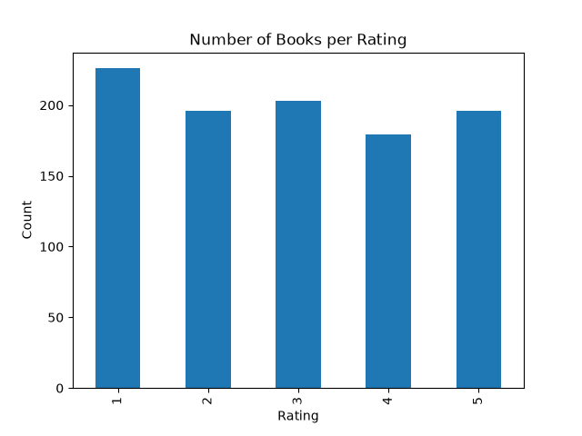
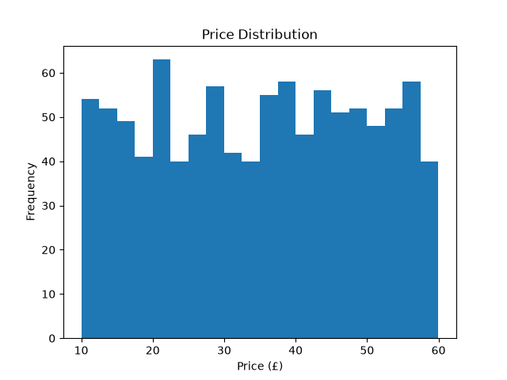

# Books Web Scraping Project

## 1. Objective
The goal of this project is to collect data from a public website using Python web scraping and turn it into a clean, custom dataset ready for analysis. I scraped book information from https://books.toscrape.com/, a practice website built for learning web scraping.

## 2. Tools Used
- Python
- requests (to download web pages)
- BeautifulSoup (to parse the HTML)
- pandas (to build and clean the dataset)
- matplotlib (to create charts)
- VS Code (development environment)

## 3. Method
1. **Inspecting the HTML:** Each book on the page is inside an `<article class="product_pod">` tag. I extracted the title from the `<a>` tag inside `<h3>`, the price from `<p class="price_color">`, the rating from the class of `<p class="star-rating">`, and the availability from `<p class="instock availability">`.
2. **Web navigation:** The site has 50 pages of 20 books each. I looped through all page URLs (`page-1.html` to `page-50.html`) to collect every book.
3. **Politeness:** I added a short delay (`time.sleep`) between requests so the website was not overloaded.
4. **Cleaning:** I removed the £ symbol and converted prices to numbers, converted the text ratings (One to Five) to numbers 1 to 5, converted availability to a True/False column, and removed duplicates and missing values.
5. **Analysis:** I calculated summary statistics and created charts with matplotlib.

## 4. Dataset Description
- **File names:** `books_raw.csv` (raw data), `books_clean.csv` and `books_clean.xlsx` (cleaned data)
- **Rows:** 1000
- **Columns:**

| Column | Description |
|--------|-------------|
| Title | Name of the book |
| Price | Price in British pounds (£), as a number |
| Rating | Star rating from 1 to 5 |
| In_Stock | True if the book is in stock |
| Link | URL of the book's detail page |

## 5. Key Findings
- Average book price: **£35.07**
- Most expensive book: **The Perfect Play (Play by Play #1)**
- Cheapest book: **An Abundance of Katherines**

### Number of books per rating

| Rating | Number of Books |
|--------|-----------------|
| 1 star | 226 |
| 2 stars | 196 |
| 3 stars | 203 |
| 4 stars | 179 |
| 5 stars | 196 |

- The most common rating is **1 star** with 226 books, and the least common is **4 stars** with 179 books.
- The ratings are spread fairly evenly across all five levels, with no single rating dominating the dataset.
- The average price of £35.07 sits roughly in the middle of the price range, so the catalogue contains a wide mix of cheap and expensive books.

### Charts



## 6. Project Files
- `scraper.py`: scrapes all 50 pages and saves `books_raw.csv`
- `clean_data.py`: cleans the data and saves `books_clean.csv` and `books_clean.xlsx`
- `analysis.py`: creates statistics and charts

## 7. How to Run
```bash
pip install requests beautifulsoup4 pandas openpyxl matplotlib
python scraper.py
python clean_data.py
python analysis.py
```

## 8. Ethics
This project uses a website designed for scraping practice. When scraping real websites, always check the site's `robots.txt` and terms of service, avoid sending too many requests too quickly, and do not collect personal data.

## 9. Conclusion
This project taught me how to read HTML structure, navigate through multiple pages, and turn messy web data into a clean, custom dataset. I scraped 1,000 books, cleaned the data with pandas, and used charts to find patterns in prices and ratings. These are the core steps of a real data collection and analysis workflow.  